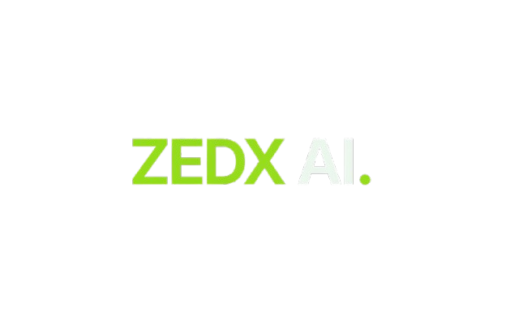
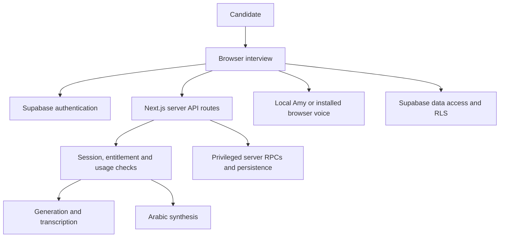
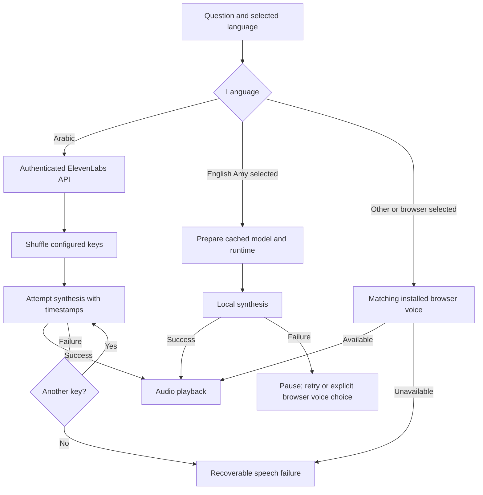
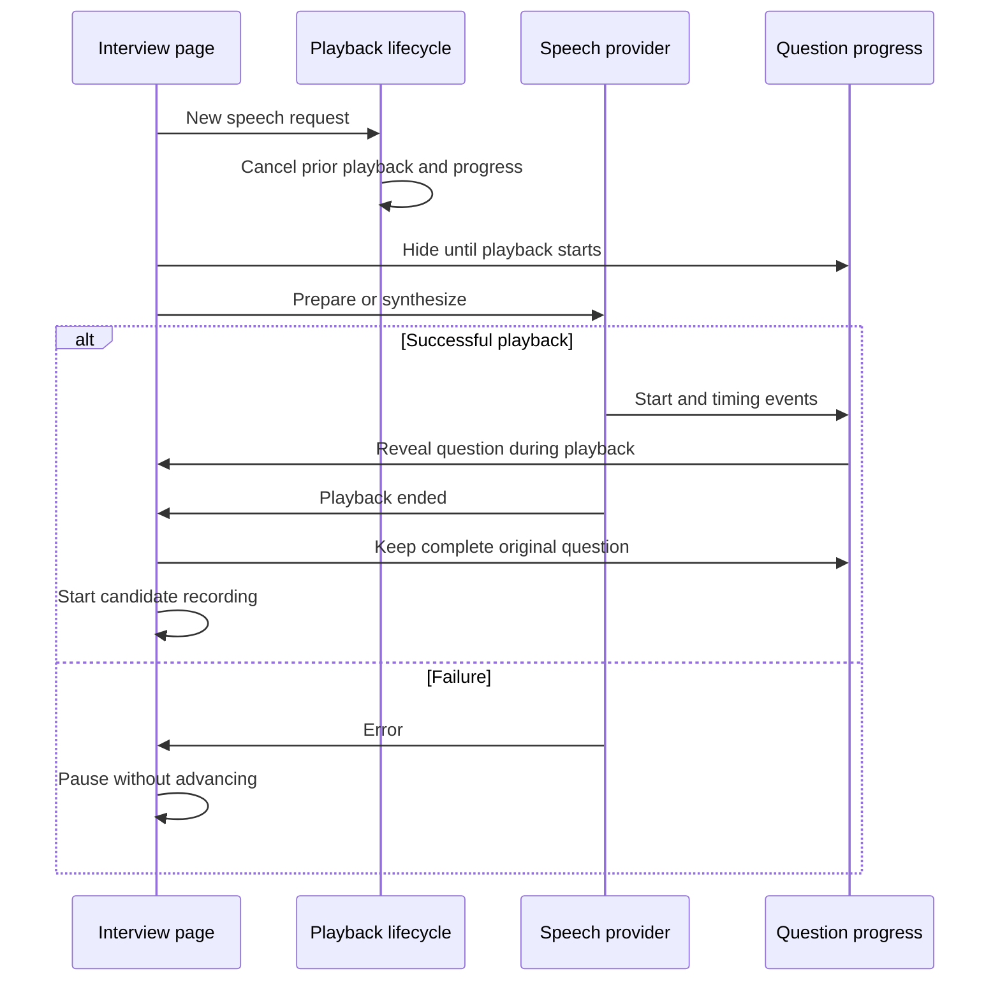
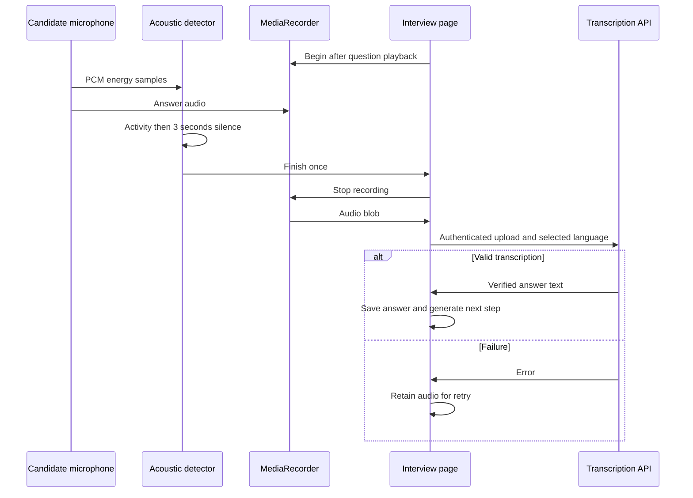
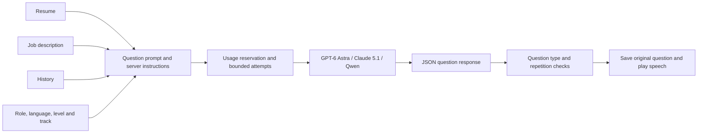
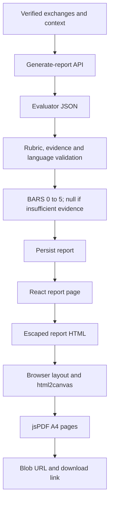
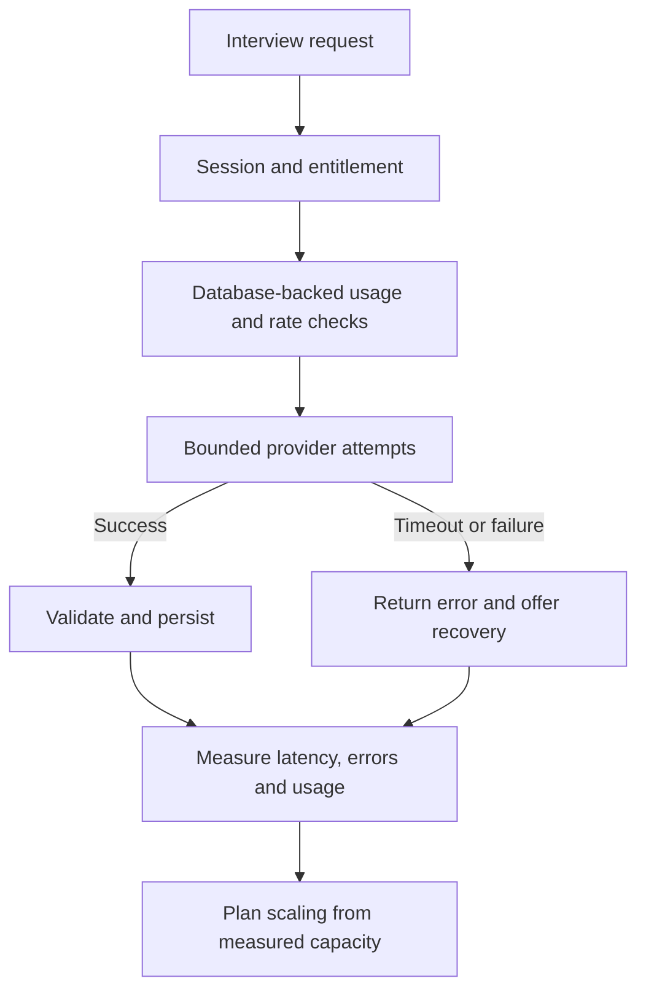

  
  <h1>ZEDX AI Simulator</h1>
  <h3>Professional AI Interview Simulation & Training Infrastructure</h3>

  <!-- Tech Stack Badges -->
  

    
    
    
    
    
    
    
  

ZEDX personalizes voice interview practice using a CV, job description, role,
difficulty and selected language. The website supports 30 session languages;
installed browser voices depend on the user's device. Reports use BARS 0–5,
with null for insufficient evidence rather than an invented zero score.

[Watch the demo](https://youtu.be/EFQORaZ4DN4)

## Local setup

Use Node.js 22 LTS and npm. Run `npm ci`, then create an untracked `.env.local`:

| Variable | Purpose |
| --- | --- |
| NEXT_PUBLIC_SUPABASE_URL | Development project URL |
| NEXT_PUBLIC_SUPABASE_ANON_KEY | Browser publishable/compatible anon credential |
| SUPABASE_SERVICE_ROLE_KEY | Server-only privileged credential |
| GROQ_API_KEY | Server-side LLM/STT credential |
| ELEVENLABS_API_KEY | Server-side Arabic TTS credential |

Numbered provider keys are optional. Pool size follows configured credentials,
not a fixed number of accounts or a guaranteed capacity. Payment/email/analytics
features have separate route configuration. Never commit actual credentials.
For a fresh database, review `supabase_schema.sql` and ordered migrations in
`supabase/migrations/` in a development project; verify permissions, policies
and RPCs before production. The README is not an automatic database bootstrap.

Run `npm run dev`, open http://localhost:3000, sign in and configure an interview.
Allow microphone/camera during setup. Production media capture needs a secure
browser context. Use `npm run build` and `npm start` for a production build.
Electron has a separate entry point and existing `npm run electron:dev` script.

## 1. System boundaries

Code: [interview page](src/app/mock-interview/page.tsx),
[generation](src/app/api/generate/route.ts),
[transcription](src/app/api/transcribe/route.ts), [TTS](src/app/api/tts/route.ts).
These are Next.js server handlers; this diagram does not assert an Edge runtime
or an Electron IPC-to-provider connection.

## 2. Speech routing

Code: [provider selection](src/lib/web-interview-language.ts),
[Amy](src/lib/piper-amy.ts), [TTS API](src/app/api/tts/route.ts).
Valid Arabic alignment controls progress; Amy timing is estimated from chunk
duration. Native voices use boundary events when available, estimates otherwise.
[Verification and limits](docs/testing/interview-speech-progress.md).
Cached bytes do not guarantee synthesis speed or successful playback.

## 3. Playback lifecycle

Code: `speakText` in the [page](src/app/mock-interview/page.tsx) and
[progress module](src/lib/interview-speech-progress.ts). Request IDs and cleanup
prevent obsolete playback from advancing the current turn.

## 4. Candidate recording and automatic submission

Code: [silence detector](src/lib/answer-silence.ts),
[recording and transcription](src/lib/web-answer-recording.ts).
Browser recognition supplies provisional captions, not the saved answer or
submission timer. No manual Send Answer is required. This is an energy detector,
not a speech classifier: noise can delay submission and quiet speech can be
missed. [Tests and remaining hardware checks](docs/testing/answer-silence.md).

## 5. Question generation

The three names are intentional product/UI marketing labels. Actual provider
identifiers and fallback order are separate configuration in
[the generation route](src/app/api/generate/route.ts); labels are not literal
provider model IDs. This route returns JSON, not an SSE question stream.
Context is bounded by API history/text limits and provider context/token budgets;
Website interview generation uses distinct contracts for Role-Specific, Behavioral,
Technical and Project Deep Dive, combined with Beginner, Intermediate or Expert
depth. Follow-up focus angles remain within the chosen type. A fresh setup's
selected difficulty takes precedence over an older browser-saved value. The first
spoken introduction remains a shared warm-up; subsequent assessment questions use
these contracts. The server also reviews generated questions for type/depth fit
alongside repetition, retries up to three proposals within the existing deadline,
and returns a recoverable error with usage release when no proposal is valid.
Focused follow-ups are judged within their parent question, not as a full new
expert scenario. Prompt regression tests cover all 12 combinations, but live-model
adherence and perceived difficulty still require representative session review.
there is no universal zero-truncation guarantee. At most one focused follow-up
per main question is requested. [Question quality logic](src/lib/interview-question-quality.ts).

## 6. Interview state and recovery

```mermaid
stateDiagram-v2
    [*] --> Setup
    Setup --> Generating: Context and permissions ready
    Generating --> Speaking: Question ready
    Generating --> GenerationError: Failure
    GenerationError --> Generating: Retry
    Speaking --> Listening: Playback ends
    Speaking --> SpeechError: Failure
    SpeechError --> Speaking: Retry or explicit voice choice
    Listening --> Transcribing: Activity then 3 seconds silence
    Transcribing --> AnswerError: Failure
    AnswerError --> Transcribing: Retry retained audio
    AnswerError --> Speaking: Record again
    Transcribing --> Generating: Valid answer; questions remain
    Transcribing --> Reporting: Interview complete
    Reporting --> ReportReady: Generated and persisted
    ReportReady --> [*]
```

Code: [interview page](src/app/mock-interview/page.tsx),
[report generation client](src/app/dashboard/report/[id]/page.tsx).
Failure recovery must retain the current question and prevent duplicate answers.
Authentication/paywall errors are not successfully completed questions.
CV/JD are untrusted: prompt guards reduce risk but do not prove injection impossible.

## 7. Evaluation and PDF export

Code: [report API](src/app/api/generate-report/route.ts),
[rubric](src/lib/rubric-evaluator.ts), [HTML](src/lib/pdf-report-generator.ts),
[PDF download](src/lib/download-report-pdf.ts).
Save as PDF downloads a real file; the optional print page is separate.
Client export rasterizes pages, so text selection/search and accessibility differ
from a PDF containing embedded text. Schema validity does not prove judgment quality.

## 8. Capacity and failure boundaries

Local Amy consumes user CPU/memory; STT/LLM and Arabic synthesis consume provider
resources. Credentials are not unlimited throughput. See [capacity plan](SCALABILITY.md).

## Verification and release

Run `npm run typecheck` and `npm run test:ci`. The workflow
`.github/workflows/ci.yml` runs both on PRs and main pushes without production
credentials. Controlled tests do not certify every browser voice, real provider,
production RLS deployment or concurrent-user capacity.

Before release, test a signed-in interview, failure/retry, real microphones in
quiet/noisy conditions, English/Arabic playback and PDF download. Run an
authorized staging load test before quoting capacity. Update diagrams alongside
code changes and distinguish local, committed and deployed behavior.

[Project rules](PROJECT_RULES.md). Engineered and developed by Ziad Emad.
